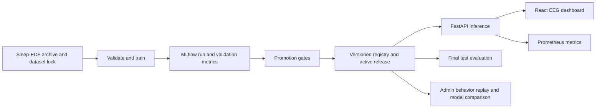

# SleepOps

The repository extends the CS495 EEG model into an end-to-end workflow. Schema-v1 archives use the original binary CNN and Transformer. Schema-v2 archives add five scored sleep-stage labels and enable a two-stage pipeline: an MLP predicts Wake/N1/N2/N3/REM for each epoch, then the awakening forecaster receives normalized EEG features concatenated with the five stage probabilities. The DVC base archive remains v1; its verified stage-labelled v2 dataset is stored as a version in the private dataset bucket. The trained stage-aware pipeline is available in Admin as a review candidate and has its own DVC model pointer.



The stage-aware run was evaluated on 16 held-out people. Stage classification reached macro F1 **0.651** and balanced accuracy **0.651**. Sleep/wake balanced accuracy was **0.850** versus **0.856** for the logistic baseline; sleep/wake macro F1 was **0.860** versus **0.858**. Awakening log loss was **1.812** versus **1.855** for the training-class prior, and within-hour Brier score was **0.235** versus **0.252**. It remains a review candidate: its validation detection metrics miss the configured promotion gates, so the UI and CI must not promote it as production.

## Run the demo stack

From the project root with Docker running, use `docker compose up --build --wait`. Open the demo at `http://127.0.0.1:8501`, interactive API docs at `http://127.0.0.1:8000/docs`, and Prometheus at `http://127.0.0.1:9090`. Shut them down with `docker compose down`. The stack binds to loopback, uses the bundled active release, and requires no service credentials.

### Run the development servers

With Python 3.11 or newer, create and activate a virtual environment and install the project. For a CPU-only environment, install the CPU PyTorch build first.

```sh
python -m pip install torch==2.6.0 --index-url https://download.pytorch.org/whl/cpu
python -m pip install -e ".[train,api,test]"
python -m uvicorn sleepops.api:app --host 127.0.0.1 --port 8000
```

For GPU training, use an environment with CUDA-enabled PyTorch and install the project extras in that environment. With Node 24 installed, start the React dashboard in a second terminal. The Vite server proxies `/api` to FastAPI on port 8000. Use `npm.cmd` in PowerShell if script execution policy blocks `npm`.

```sh
npm ci --prefix frontend
npm run dev --prefix frontend
```

The dashboard accepts `.npy` and headerless `.csv` feature windows. To browse examples, choose a held-out recording and use the timestamp picker, scrubber, or navigation buttons. The input panel shows the exact five minutes used for the prediction.

## Train and release a model

To train entirely online, open **Actions → SleepOps cloud training → Run workflow** on GitHub and select the deployment branch (`sleepops`). Set the maximum epochs and leave held-out test evaluation off while tuning. The hosted CPU runner restores the private DVC archive, validates the dataset lock, and selects the checkpoint by validation loss. The job summary links to the private checkpoint and reports in the Hugging Face bucket under `training-runs/`. A completed training run creates a candidate. Promotion is a separate validation-gated decision.

To train locally, use these commands.

```sh
python -m sleepops validate --lock configs/dataset.json
python -m sleepops train --config configs/train.toml --device auto
```

The archive lock records its SHA-256, feature order, split membership fingerprints, and split sizes. Train and evaluation refuse a mismatched archive. Both pipelines preserve subject-wise splits and fit normalization on training epochs only. The v1 model selects by the mean of validation detection BCE and forecast cross-entropy. For v2, the stage classifier is selected on validation stage cross-entropy; subject-grouped out-of-fold stage probabilities are generated for training examples; and the awakening forecaster is selected on validation forecast cross-entropy. Test subjects are evaluated only after selection. MLflow records losses, parameters, archive and code fingerprints, validation baseline comparisons, and the checkpoint.

To create schema v2 without recomputing EEG features, run `Sleep_EDF_Wake_Up_Prediction_Colab.ipynb` and upload the existing schema-v1 archive when prompted. It downloads expert hypnograms, checks them against the archived binary labels, adds five-class stage labels, and retains the original subject splits and EEG arrays. The current stage-labelled archive is already registered in **Admin > Data**; choose that version for future stage-aware training. `Sleep_Stage_Awakening_Training_Colab.ipynb` is the standalone Colab training and evaluation route.

In **Admin > Data**, add a prepared SleepOps `.npz` archive either from a local file or a direct public HTTPS download link. Imports are size-limited, checked against the recording, feature, label, timestamp, and split contract, and saved as private DVC-backed dataset versions. Raw EDF/EDF+ recordings must first go through the preprocessing notebook to produce the prepared feature archive.

```sh
mlflow ui --backend-store-uri sqlite:///runtime/mlflow.db --host 127.0.0.1 --port 5000
```

Training writes `runtime/runs/<run-id>` and uses local SQLite and file artifacts by default. Set `MLFLOW_TRACKING_URI` to use an existing tracking service. `python -m sleepops bootstrap --promote` imports the original notebook checkpoint as a new tracked run and validates it before promotion.

```sh
python -m sleepops promote --run RUN_ID
python -m sleepops evaluate --run RUN_ID --device auto
python -m sleepops status
```

Promotion checks the dataset lock, artifact checksums, causality, minimum validation cohort size, configured metric bounds, and performance against both validation baselines. See `configs/promotion.json` for the exact gate. The test command runs after selection and writes the independent test report and forecast plot. Promotion uses validation metrics exclusively.

The registry stores each promoted release under `registry/releases/<run-id>`. An atomic pointer in `registry/champion.json` selects the release. The API loads it at startup. To roll back, run `python -m sleepops activate --release PREVIOUS_RUN_ID` and restart the API. With Compose, use `docker compose restart api`. Run `python deploy/smoke_http.py` after deploying or rolling back.

## API and monitoring

`POST /v1/predict` accepts JSON with a `features` matrix containing ten chronological rows of eleven unscaled EEG features. The final row ends at prediction time. See `GET /v1/schema` for the feature order. The response includes the release ID, ten sleep probabilities, the latest state, and the forecast distribution when that state is asleep. The released model uses a sleep threshold of 0.50.

| Endpoint | What it returns |
|---|---|
| `/health/live` and `/health/ready` | Service status and active release |
| `/model` | Model release, archive fingerprint, and threshold |
| `/monitor/drift` | Aggregate sample count and feature drift |
| `/metrics` | Prometheus request outcomes, state counts, latency, and drift |

The service counts features in bins derived from unique training epochs and reports Population Stability Index after 100 valid windows. PSI of 0.25 or higher triggers a drift warning. The monitor keeps aggregate counts in the serving process. Overlapping windows contribute repeated epoch observations. Drift indicates a shift in inputs, and measuring prediction accuracy still requires new labels.

## Verification

Run `python -m pytest` to check the data lock, promotion and rollback, corrupted-artifact rejection, API responses, and drift behavior. GitHub Actions runs the checks, builds the Compose stack and Space image, and exercises the API over HTTP. The [Hugging Face guide](HUGGING_FACE.md#continuous-deployment) lists the GitHub settings to enable deployment of the app, checkpoint, and DVC dataset.

The full project bundle includes the shipped run’s test metrics, forecast plot, MLflow summary, and verification report in `reports/`. The original preprocessing and model presentation are documented in [the CS495 README](README.md).
