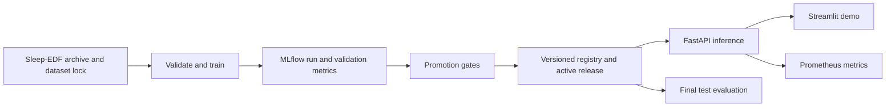

# SleepOps

The repository extends the CS495 causal CNN–Transformer into an end-to-end workflow. The bundle includes the original Colab work, the versioned Sleep-EDF feature archive, and an active release from a full GPU training run through the CLI.



## Run the demo stack

From the project root with Docker running, use `docker compose up --build --wait`. Open the demo at `http://127.0.0.1:8501`, interactive API docs at `http://127.0.0.1:8000/docs`, and Prometheus at `http://127.0.0.1:9090`. Shut them down with `docker compose down`. The stack binds to loopback, uses the bundled active release, and requires no service credentials.

### Run in Python

With Python 3.11 or newer, create and activate a virtual environment and install the project. For a CPU-only environment, install the CPU PyTorch build first.

```sh
python -m pip install torch==2.6.0 --index-url https://download.pytorch.org/whl/cpu
python -m pip install -e ".[train,api,demo,test]"
python -m uvicorn sleepops.api:app --host 127.0.0.1 --port 8000
```

For GPU training, use an environment with CUDA-enabled PyTorch and install the project extras in that environment. In a second terminal, start the demo with `SLEEPOPS_API_URL` pointing to the running API. The commands below use PowerShell. On a POSIX shell, set the same variable with `export SLEEPOPS_API_URL=http://127.0.0.1:8000`.

```powershell
$env:SLEEPOPS_API_URL = "http://127.0.0.1:8000"
python -m streamlit run demo.py
```

Omit the variable to use the original local-checkpoint mode. Both modes accept `.npy` and headerless `.csv` feature windows and include example windows from held-out recordings.

## Train and release a model

```sh
python -m sleepops validate --lock configs/dataset.json
python -m sleepops train --config configs/train.toml --device auto
```

The archive lock records its SHA-256, feature order, split membership fingerprints, and split sizes. Train and evaluation refuse a mismatched archive. Training uses the original subject assignments, fits the scaler on training epochs, and selects the lowest mean of the validation detection BCE and forecasting cross-entropy. The CLI prints a run ID. MLflow records per-epoch losses, parameters, archive and code fingerprints, validation baseline comparisons, and the checkpoint.

```sh
mlflow ui --backend-store-uri sqlite:///runtime/mlflow.db --host 127.0.0.1 --port 5000
```

Training writes `runtime/runs/<run-id>` and uses local SQLite and file artifacts by default. Set `MLFLOW_TRACKING_URI` to use an existing tracking service. `python -m sleepops bootstrap --promote` imports the original notebook checkpoint as a new tracked run and validates it before promotion.

```sh
python -m sleepops promote --run RUN_ID
python -m sleepops evaluate --run RUN_ID --device auto
python -m sleepops status
```

Promotion checks the dataset lock, artifact checksums, causality, minimum validation cohort size, configured metric bounds, and performance against both validation baselines. See `configs/promotion.json` for the exact gate. The test command runs after selection and writes the independent test report and forecast plot. Promotion uses validation metrics exclusively.

The registry stores each promoted release under `registry/releases/<run-id>`. An atomic pointer in `registry/champion.json` selects the release. The API loads it at startup. To roll back, run `python -m sleepops activate --release PREVIOUS_RUN_ID` and restart the API. With Compose, use `docker compose restart api`. Run `python deploy/smoke_http.py` after deploying or rolling back.

## API and monitoring

`POST /v1/predict` accepts JSON with a `features` matrix containing ten chronological rows of eleven unscaled EEG features. The final row ends at prediction time. See `GET /v1/schema` for the feature order. The response includes the release ID, ten sleep probabilities, the latest state, and the forecast distribution when that state is asleep. The released model uses a sleep threshold of 0.50.

| Endpoint | What it returns |
|---|---|
| `/health/live` and `/health/ready` | Service status and active release |
| `/model` | Model release, archive fingerprint, and threshold |
| `/monitor/drift` | Aggregate sample count and feature drift |
| `/metrics` | Prometheus request outcomes, state counts, latency, and drift |

The service counts features in bins derived from unique training epochs and reports Population Stability Index after 100 valid windows. PSI of 0.25 or higher triggers a drift warning. The monitor keeps aggregate counts in the serving process. Overlapping windows contribute repeated epoch observations. Drift indicates a shift in inputs, and measuring prediction accuracy still requires new labels.

## Verification

Run `python -m pytest` to check the data lock, promotion and rollback, corrupted-artifact rejection, API responses, and drift behavior. GitHub Actions runs the checks, builds the Compose stack and Space image, and exercises the API over HTTP. The [Hugging Face guide](HUGGING_FACE.md#continuous-deployment) lists the GitHub settings to enable deployment of the app, checkpoint, and DVC dataset.

The full project bundle includes the shipped run’s test metrics, forecast plot, MLflow summary, and verification report in `reports/`. The original preprocessing and model presentation are documented in [the CS495 README](README.md).
